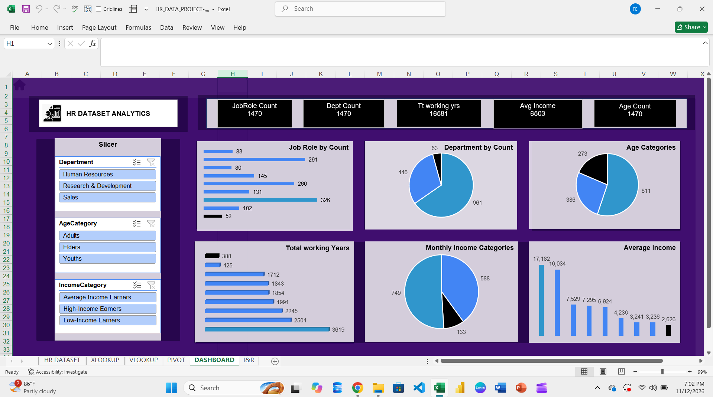

# HR Dataset Analytics - Excel Dashboard

## 📊 Overview
HR Analytics project analyzing 1,470 employees. Built fully in Microsoft Excel with interactive dashboard.

## 🖼️ Dashboard Preview

## 📈 KPIs
- JobRole Count: 1470
- Dept Count: 1470
- Total Working Years: 16,581
- Avg Income: 6,503

## 🛠️ Skills: PivotTables, PivotCharts, Slicers, XLOOKUP, VLOOKUP, Excel Dashboard

## 💡 Insights
- 961 employees in major dept, 511 Youths, 326 in top job role
- Income segmentation: Low / Average / High
- HR_DATA_PROJECT.xlsx - Full workbook with dashboard
- images/dashboard.png - Dashboard preview
